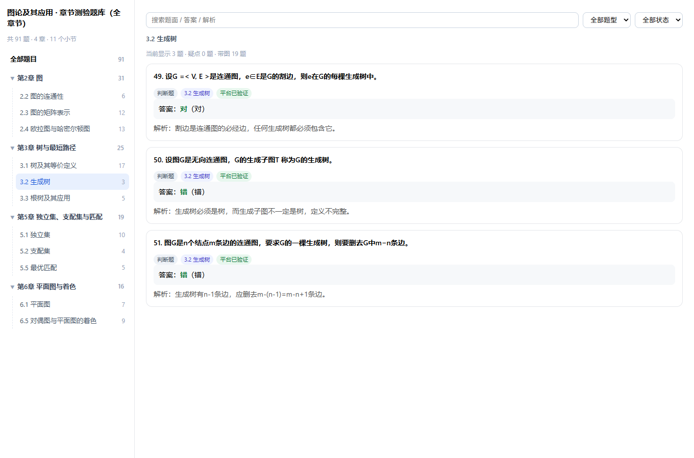

# 图论及其应用 · 章节测验题库（全章节）

由 `tools/bank-builder` 接管浏览器自动作答、按平台判分回炉采集而成。



## 内容

| 文件 | 说明 |
|---|---|
| `questions.json` | 题库主文件，含题面、选项、答案、图片、解析、验证状态与疑点 |
| `answers.csv` | 表格版（Excel 可直接打开） |
| `index.html` | 离线查看器：搜索、题型筛选、只看疑点、高亮正确选项、显示题干图片 |
| `images/` | 题干/选项里的图片（已本地化，共 47 张，覆盖 19 题） |

统计：**91 题**，平台已验证 **91**，疑点 **0**。

题型：单选题 28 / 多选题 30 / 判断题 31 / 连线题 2

## 覆盖章节

| 章节 | 题数 |
|---|---|
| 2.2 图的连通性 | 6 |
| 2.3 图的矩阵表示 | 12 |
| 2.4 欧拉图与哈密尔顿图 | 13 |
| 3.1 树及其等价定义 | 17 |
| 3.2 生成树 | 3 |
| 3.3 根树及其应用 | 5 |
| 5.1 独立集 | 10 |
| 5.2 支配集 | 4 |
| 5.5 最优匹配 | 5 |
| 6.1 平面图 | 7 |
| 6.5 对偶图与平面图的着色 | 9 |

其余小节（1.1–1.5、2.1、3.4–3.6、5.3、5.4、5.6、6.2–6.4、6.6）没有章节测验，未采集。

## 关于图片

题干/选项里的图（图形题、公式图）已下载到 `images/`，题目的 `images` 字段存的是相对路径，
`stemHtml` 里也内联了 ``，离线打开查看器即可看到原图。

> 少数下载失败（平台防盗链/图片已删）的条目会保留原始 URL，需联网才能显示。

## 关于连线题

「请给下列各图归类」这类题，平台按一道大题呈现，实际答案是「图1→第一组、图2→第二组…」的映射。
题库里记为 `type: "连线题"`，并给出 `subItems`，查看器按每张图一道选择题展示：

```json
{
  "type": "连线题",
  "groups": ["欧拉图", "非欧拉图"],
  "answer": "1-B 2-B 3-B 4-B",
  "subItems": [
    { "no": 1, "answer": "B", "target": "非欧拉图" }
  ]
}
```

## 字段说明

- `answer`：选择题为选项字母（多选如 `A,C`）；判断题为「对/错」；连线题为 `1-B 2-B …`
- `images`：题目图片的相对路径数组（如 `["images/8f3a-1-2b81c9.png"]`）
- `verified`：平台是否确认答对
- `flags`：疑点，可能的值：`未验证`、`答案冲突`、`不支持题型`、`答案不完整`、`半对半错`
- `explanation`：AI 生成的解析
- `subItems` / `groups`：仅连线题有

## 怎么用

1. **离线查看**：双击 `index.html`（图片随目录一起拷走即可）。
2. **导入油猴脚本**：「⚙️ 全局设置 → 本地题库 → 导入题库文件」，选 `questions.json`。
   脚本会按「题面 + 选项文本」匹配，平台打乱选项也不会答错；连线题会自动跳过。
3. **重新采集**：见 [tools/bank-builder/USAGE.md](../../tools/bank-builder/USAGE.md)。
